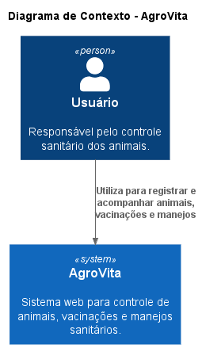
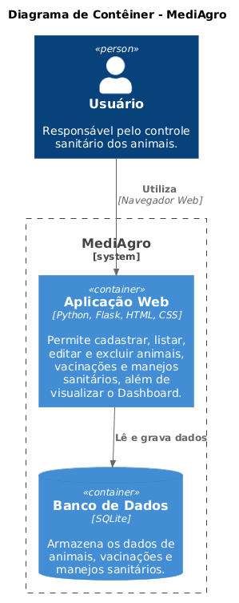
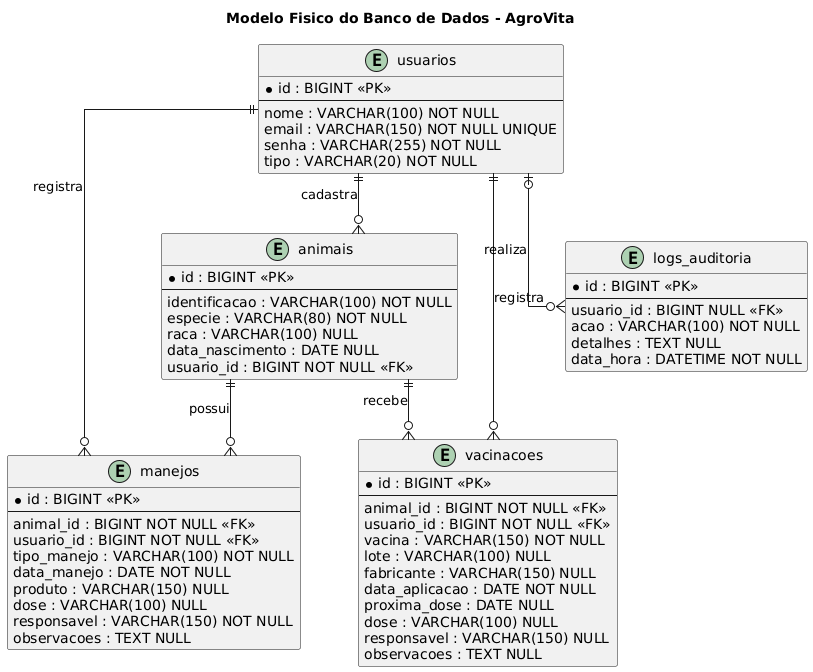
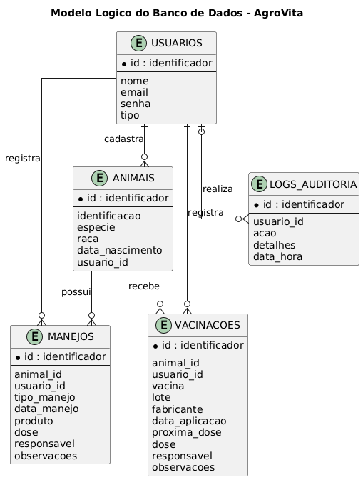
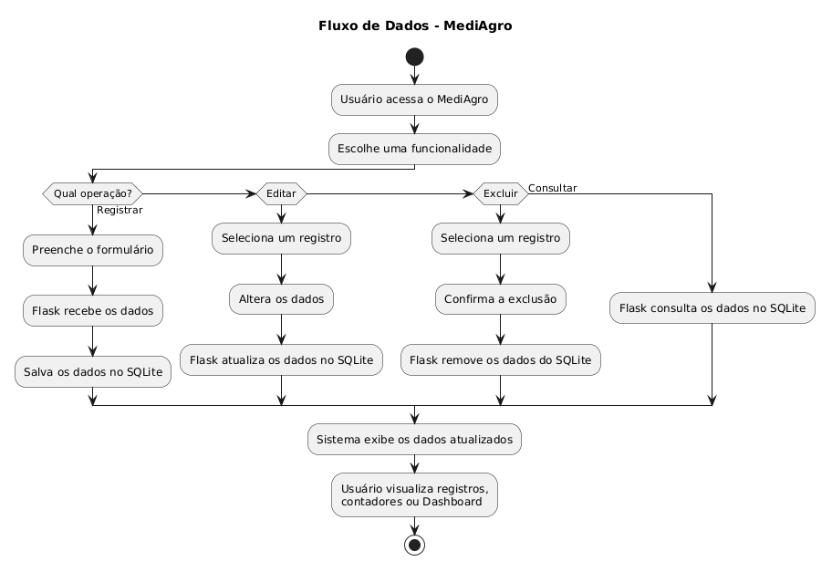

# AgroVita — Controle de Manejo Sanitário e Vacinação

🌐 **Sistema publicado:** https://laisy2k.pythonanywhere.com/  
📦 **Repositório:** https://github.com/laisy2k/agrovita

## Sobre o projeto

O AgroVita é um sistema web desenvolvido para auxiliar no controle sanitário de animais, permitindo organizar informações sobre animais, vacinações e manejos sanitários.

O sistema utiliza Python, Flask e MySQL, com interface construída em HTML, CSS e JavaScript.

## Funcionalidades

- Cadastro, consulta, edição e exclusão de animais.
- Registro e gerenciamento de vacinações.
- Registro e gerenciamento de manejos sanitários.
- Acompanhamento das informações de vacinação.
- Dashboard com informações gerais do sistema.
- Autenticação e controle de acesso de usuários.
- Registro de eventos para auditoria.

## Tecnologias utilizadas

- Python
- Flask
- MySQL
- mysql-connector-python
- python-dotenv
- HTML5
- CSS3
- JavaScript
- Chart.js
- PlantUML
- Git e GitHub

## Arquitetura e diagramas

Os diagramas e documentos técnicos estão disponíveis no diretório `docs/` e na raiz do repositório.

### Diagrama de contexto — C4 nível 1



### Diagrama de contêiner — C4 nível 2



### Modelo físico do banco de dados



### Modelo lógico do banco de dados



### Fluxograma do processo



## Estrutura do projeto

```text
agrovita/
├── app.py
├── templates/
├── static/
├── docs/
│   ├── dump_agrovita.sql
│   ├── restauracao_banco.md
│   ├── rotinas_banco.sql
│   ├── seguranca.md
│   ├── testes_rotinas_sql.md
│   └── usuarios_permissoes.md
├── diagrama_contexto.puml
├── diagrama_container.puml
├── modelo_banco_dados.puml
├── modelo_logico.puml
├── fluxograma_processo.puml
├── requirements.txt
├── .gitignore
└── README.md
```

## Requisitos para execução local

- Python instalado.
- MySQL Server instalado e em execução.
- Banco de dados configurado conforme a documentação do projeto.

## Como executar o projeto

### 1. Clonar o repositório

```bash
git clone https://github.com/laisy2k/agrovita.git
cd agrovita
```

### 2. Criar um ambiente virtual

No Windows:

```powershell
python -m venv .venv
.venv\Scripts\Activate.ps1
```

### 3. Instalar as dependências

```bash
pip install -r requirements.txt
```

### 4. Configurar as variáveis de ambiente

Crie um arquivo `.env` na raiz do projeto com as configurações do MySQL e da aplicação.

As variáveis necessárias são:

- `DB_HOST`
- `DB_PORT`
- `DB_NAME`
- `DB_USER`
- `DB_PASSWORD`
- `SECRET_KEY`

Preencha os valores de acordo com o ambiente local. Utilize uma chave secreta própria e mantenha o arquivo `.env` fora do controle de versão.

Não publique senhas, chaves secretas ou credenciais reais.

### 5. Preparar o banco de dados

Configure o banco MySQL, os usuários e as permissões conforme `docs/usuarios_permissoes.md`.

O arquivo `docs/dump_agrovita.sql` contém a estrutura do banco e as rotinas SQL, sem os registros armazenados. Consulte `docs/restauracao_banco.md` para obter as instruções de restauração.

### 6. Executar a aplicação

```bash
python app.py
```

Acesse no navegador:

```text
http://127.0.0.1:5000
```

A execução depende de o MySQL estar configurado e acessível e de as variáveis de ambiente estarem preenchidas corretamente.

## Banco de dados e segurança

O projeto utiliza MySQL e documenta usuários com diferentes níveis de permissão, rotinas SQL, gatilhos de validação e mecanismos de autenticação, controle de acesso, sessões e auditoria.

Consulte os documentos em `docs/` para conhecer as configurações, os testes realizados e os procedimentos de backup e restauração.

## Desenvolvimento

O desenvolvimento é organizado por meio de Issues, branches, commits e Pull Requests no GitHub.

## Links

- **Repositório:** https://github.com/laisy2k/agrovita
- **Sistema publicado:** https://laisy2k.pythonanywhere.com/
- **Issues:** https://github.com/laisy2k/agrovita/issues

## Desenvolvedora

Kezia Laís — desenvolvimento do AgroVita.
